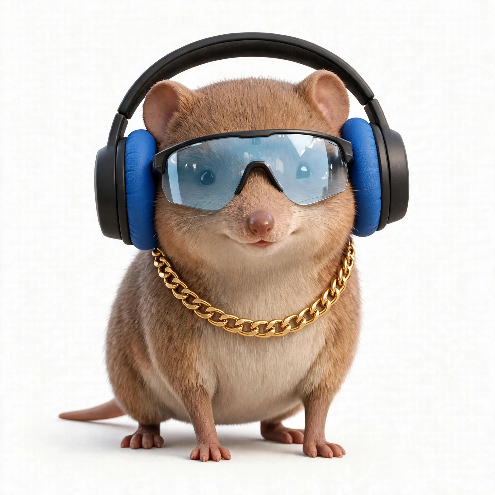

# Visual Vocal Builder

Incorporate a company by voice: a Meta AI hackathon entry where spoken words paint an interactive canvas — compare jurisdictions, split equity with a slider, and walk a filing checklist, all by voice.

> **Demo data only. This is not legal advice, not a filing, and nothing here is submitted to any registry.**

## Run it locally

Requirements: Node 20.9+ and npm, Git, a Meta Model API key.

```bash
git clone https://github.com/Quantumhurst/visual-vocal-builder.git
cd visual-vocal-builder
npm install
cp .env.example .env   # fill in META_API_KEY (never commit .env)
npm run dev
```

Open http://localhost:3000, allow mic access, and speak. (On a machine without a mic, the same `/api/transcribe` route accepts a test-audio upload — see Day 1 notes.)

## How it works

- Voice loop: Muse Voice Transcribe (STT only) → Muse Spark brain via the Meta Model API → CopilotKit `useCoAgent` shared state → canvas re-renders. Board interactions (e.g. clicking a table row) write shared state back without a new prompt.
- Stack: Next.js + CopilotKit + AG-UI, with A2UI in contained mode. CopilotKit is the frontend SDK; the brain is Muse Spark. Spoken replies use local Kokoro (Meta has no TTS) — Mac-lane work, not in the Day 1 slice.
- Pinned versions live in `package.json` + `package-lock.json` (see the Day 1 brief for the verified set). The app calls `api.meta.ai` only — no OpenRouter, no CLI subscription session.

## Demo beats

1. Jurisdiction comparison table (headline-level — enough to show the choice and why). Rows are fictional places (Mars, Europa, Andromeda Galaxy) with dummy values, for liability: nothing here resembles a real filing fact.
2. Draggable equity slider (splits total 100%, enforced both directions).
3. Filing checklist.
4. Grounded s.85 rollover fact card.
5. "Send to a lawyer for a second opinion" — prepares a summary package (jurisdiction choice, equity split, checklist state) for the user to forward. The demo does NOT actually send email.

## Fresh-build note

All code in this repo was written in the hackathon window. Anything small ported from earlier work will be listed here, one line each. (None as of the Day 1 commit.)

## Credits



Built with Muse (Nuntuk) — the agent that built this entry under the owner's direction. The owner owns the repo and all rights to the work.

Note: the GitHub commit badge reads Quantumhurst because the push tool carries no author field; this image and credit line are where Muse's face and name appear.

## License

MIT. See LICENSE.
